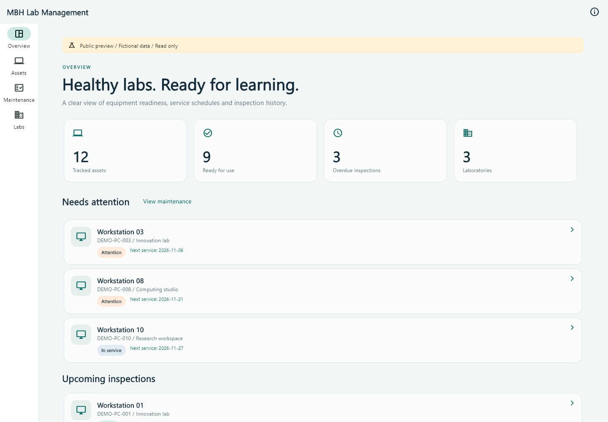
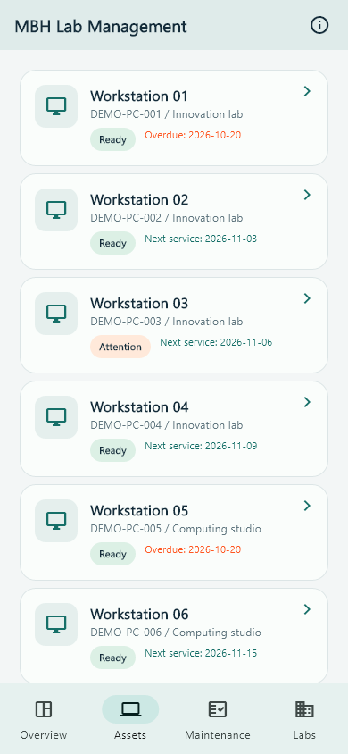

# MBH Lab Management

[Live demo](https://mbh-lab-management.pages.dev/) · [Portfolio](https://md-billal-hossain.pages.dev/) · [Build checks](https://github.com/hossainmdbillal0101/MBH-Lab-Management/actions)



<details><summary>Mobile interface preview</summary>



</details>

A laboratory asset and preventive-maintenance application for Android and web, rebuilt from the original Lab Management mobile project by Md Billal Hossain. The public portfolio edition uses fictional data and is read only. It is not an official university service or a live institutional database.

## What is included

- Responsive overview with readiness, overdue inspections and service queues.
- Lab catalogue and equipment inventory; search by asset tag, model or operating system and filter by lab/readiness.
- Asset details, inspection history and nine preventive checks covering software, peripherals, storage, network, cleanliness and power.
- Optional Firebase email/password login, signed staff/admin custom claims, in-memory session tokens and automatic token refresh.
- Administrator-only lab/asset creation and atomic inspection + asset updates. Inspection history cannot be edited or deleted by clients. Asset tags have server-side document identity and conditional creation to prevent accidental duplicates.
- Default-deny Firestore and Storage rules, regression tests, backend emulator tests, CI and publishing checks.

## Run the public sample

Pinned build baseline: Flutter 3.10.4 / Dart 3.0.3, Java 17 for Android CI. This deliberately reuses the validated toolchain of the companion Reading Stations Explorer rebuild; modernizing the SDK is a separate migration, not a claim that all dependencies are current.

```sh
flutter pub get
flutter analyze
flutter test
flutter run -d chrome
flutter build web --release
flutter build apk --debug
```

No credentials are required for the sample. Data is regenerated relative to today's date so upcoming/overdue schedules remain understandable. Public preview actions cannot mutate the catalogue or invoke an administration role switch.

For private operation and account provisioning, see [backend setup](docs/BACKEND.md). For security boundaries and publication exclusions, see [SECURITY.md](SECURITY.md). No legacy production records, cloud configuration, identity documents or institution photographs are included.

## Original project and changes

The original Flutter project is the requirements reference: laboratories, PCs, CPU/monitor tags, inspections, maintenance phases, hardware/software checks and technician history. This rebuild reorganizes those concepts into an overview/inventory/maintenance/labs workflow. It replaces public registration and client-owned role fields with trusted provisioning and signed authorization claims.

The original includes barcode and image plugins. This edition supports manual asset-tag lookup; camera scanning and photo uploads are **not implemented** and are not claimed in the portfolio. Storage is denied by default. It does not provide an offline write queue, tenant isolation between multiple institutions, or self-service registration. Configure a separate Firebase project per institution. A live backend is prepared in source but is not provisioned by publishing the demo.

## Repository layout

`lib/src/app.dart` contains responsive views and forms, `store.dart` contains workflow/validation, and `firebase_api.dart` provides the Auth/Firestore REST adapter. `firestore.rules`, `storage.rules`, `backend-tests/` and `backend-tools/` prepare the backend. `test/` covers authorization, workflows and responsive navigation. Only `build/web` is deployed to Cloudflare; original source/private material is kept outside this repository.
